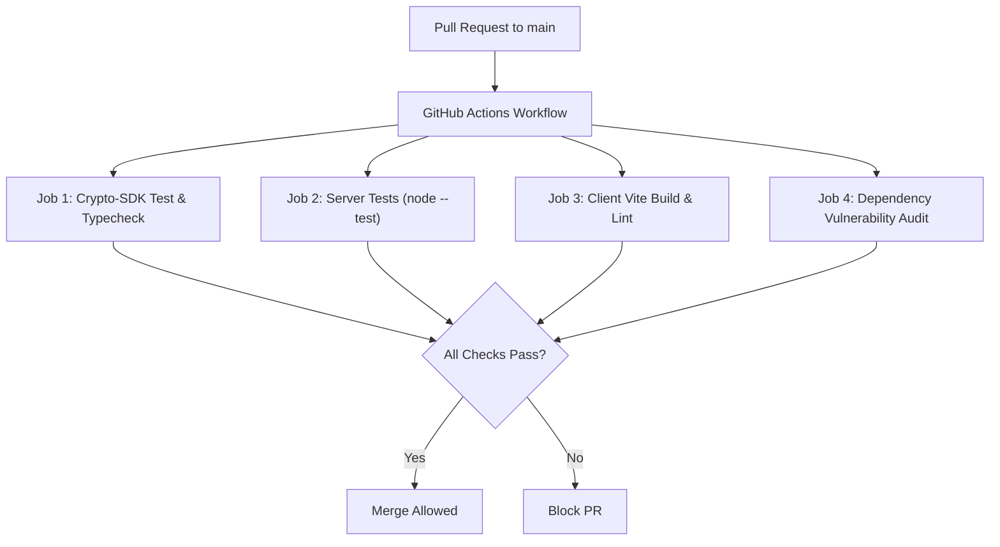

# CI/CD AND RELEASE ENGINEERING AUDIT
**Audit Date:** November 2026  
**Scope:** GitHub Actions Workflows, Release Automation, Pipeline Coverage

---

## 1. Automated Pipeline Inventory

| Pipeline File | Target Scope | Trigger Conditions | Jobs & Steps | Assessment |
| :--- | :--- | :--- | :--- | :--- |
| [`.github/workflows/crypto-sdk.yml`](file:///home/pranav/Documents/MERN-Stack-Chat-App/.github/workflows/crypto-sdk.yml) | `crypto-sdk/**` only | Push / PR on crypto-sdk paths | Lint, typecheck, test, build on Node 18, 20, 22 | Well-configured for Crypto SDK |
| **Server CI Workflow** | `server/**` | **None** | None | **MISSING** (No automated CI runs `npm test` on PRs) |
| **Client CI Workflow** | `client/**` | **None** | None | **MISSING** (No automated CI runs `vite build` or lint) |

---

## 2. Release Engineering Deficiencies

1. **Missing Server CI:**
   Because there is no GitHub Action workflow executing `npm test` inside `server/`, the broken import of `server/media/` and the 3 failing tests slipped into the `main` branch undetected.
2. **Missing Build Verification for Frontend:**
   No CI job verifies that `npm run build` succeeds in `client/` before code is merged.
3. **Missing Automated Security Scanning:**
   No Dependabot, npm audit, secret scanning, or CodeQL static analysis workflows are configured.

---

## 3. Recommended CI/CD Pipeline Architecture

---

## 4. Key Findings

- **FINDING-CICD-01 (High):** Absence of CI workflows for `server/` and `client/` allows regressions and broken imports to reach the production branch.
- **FINDING-CICD-02 (Medium):** Absence of automated secret scanning in CI.
