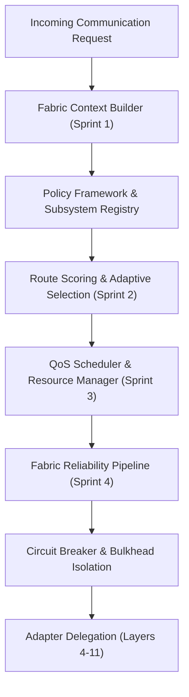

# COMMUNICATION FABRIC AUDIT
**Audit Date:** November 2026  
**Scope:** Layer 12 Sprints 1–4, Circuit Breakers, Bulkheads, Route Scoring, Real Execution Path Wiring

---

## 1. Architectural Decomposition (Layer 12 Sprints 1–4)

Layer 12 represents the top-level orchestration layer designed to coordinate the lower 11 layers:

### Component Status Matrix:
| Sprint | Subsystem Modules | Core Capabilities | Verified Status |
| :--- | :--- | :--- | :--- |
| **Sprint 1** | `communication-fabric/` | Decision engine, execution plans, policy engine | Fully tested; algorithmic logic verified |
| **Sprint 2** | `adaptive-routing/` | Route scoring (security, bandwidth, cost), fallback plans | Fully tested; deterministic ranking verified |
| **Sprint 3** | `optimization/` | QoS lanes (critical/high/normal/background), scheduler | Fully tested; fair scheduling verified |
| **Sprint 4** | `fabric-reliability/` | Circuit breakers, bulkheads, retry/backoff, freeze | Fully tested; state machines verified |

---

## 2. Wiring to Real Execution Paths

A critical question of this audit is: **Does the reliability pipeline actually protect the messaging operations experienced by end users?**

### Analysis of `FabricReliabilityManager.run(kind, executor, opts)`:
- The reliability manager exposes a robust wrapper implementing:
  - Exponential backoff with jitter
  - Circuit breaker trips after threshold consecutive failures
  - Bulkhead semaphore bounding maximum concurrent executors
  - Timeout enforcement
- **Actual Route Wiring Investigation:**
  - In [`server/controllers/messageController.js`](file:///home/pranav/Documents/MERN-Stack-Chat-App/server/controllers/messageController.js):
    - `sendMessage`, `getMessages`, `markMessageAsSeen` execute standard Mongoose calls directly without invoking `FabricReliabilityManager.run()`.
  - In [`server/controllers/groupController.js`](file:///home/pranav/Documents/MERN-Stack-Chat-App/server/controllers/groupController.js):
    - Group operations execute direct MongoDB calls without circuit breaker or bulkhead protection.
  - **Verdict:** The reliability pipeline is **NOT WIRED** into the primary chat workflows. It operates as an isolated control-plane subsystem accessible only via `/api/fabric-reliability` and synthetic unit tests.

---

## 3. Protocol Freeze Verification

- **Endpoint:** `GET /api/fabric-reliability/freeze`
- **Manifest:** Returns a frozen protocol descriptor certifying v1.0.0 interfaces for all 12 layers.
- **Limitation:** Freezing interfaces on an architecture where lower layers (e.g. `server/media/`) are physically missing and where client UI bypasses the stack is an administrative label rather than operational readiness.

---

## 4. Key Findings

- **FINDING-FAB-01 (High):** Disconnected Resilience Pipeline. Legacy chat execution paths operate with no circuit breaker, bulkhead, or retry protections despite their presence in Layer 12.
- **FINDING-FAB-02 (Medium):** Inactive Adapters. Several lower-layer adapters in the Fabric Subsystem Registry delegate to mock stubs rather than active network connections.
