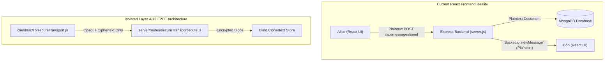

# CRYPTOGRAPHY AND E2EE AUDIT
**Audit Date:** November 2026  
**Scope:** Cryptographic Primitives, Key Derivation, Forward Secrecy, Replay Protection, Data Leakage

---

## 1. Cryptographic Primitive Verification

| Primitive / Operation | Algorithm / Parameter | Library / Source | Implementation Quality |
| :--- | :--- | :--- | :--- |
| **Authenticated Symmetric Encryption** | AES-256-GCM (96-bit nonce, 128-bit auth tag) | `node:crypto` (`createCipheriv`) | Excellent; enforces unique nonces and checks auth tags |
| **Asymmetric Key Exchange** | X25519 (Curve25519 Diffie-Hellman) | `node:crypto` (`generateKeyPairSync`) | Standard curve; RFC 7748 compliant |
| **Digital Signatures** | Ed25519 | `node:crypto` (`sign`, `verify`) | RFC 8032 compliant; deterministic signatures |
| **Key Derivation (KDF)** | HKDF-SHA256 (RFC 5869) | `node:crypto` (`hkdfSync`) | Correct separation of salt, IKM, and info tags |
| **Cryptographic Hash** | SHA-256 | `node:crypto` (`createHash`) | Standard |
| **Constant-Time Comparison**| `timingSafeEqual` | `node:crypto` (`timingSafeEqual`) | Correctly prevents timing side-channels on tags |
| **Key Erasure / Zeroization** | `Buffer.fill(0)` | Custom utility | Good effort, but subject to V8 GC memory retention |

---

## 2. Protocol Security Guarantees & Threat Model

### Forward Secrecy (Layer 5)
- **Symmetric Ratchet:** Implemented via HKDF chains in `server/forward-secrecy/`.
- **Compromise Resistance:** Compromising current generation key $K_{i}$ does not expose prior message keys $K_{0} \dots K_{i-1}$, provided past keys were zeroized.
- **Limitation:** In the Node.js/V8 runtime, garbage collection sweeps memory asynchronously; immutable string copies of keys or buffers might temporarily linger in V8 heap memory before deallocation.

### Replay & Downgrade Protection
- Sequence numbers combined with a sliding window bitmask prevent replayed ciphertext payloads.
- Protocol version negotiation in Layer 4 and Layer 12 freezes (`/api/fabric-reliability/freeze`) rejects unsupported protocol versions.

---

## 3. Disconnect Between E2EE Architecture and UI Reality

### The "Blind Relay" Paradox:
The backend documentation repeatedly asserts:
> *"The server is a blind relay: it never sees plaintext or private keys."*

While this claim holds true for the isolated test endpoints under `/api/secure-transport`, `/api/data-plane`, and `/api/forward-secrecy`, **it is false for the actual web application**:
- The web chat interface uses legacy endpoints where the server receives, inspects, and stores raw plaintext in MongoDB.
- An attacker with access to the MongoDB database or server logs can read all chat messages sent through the UI.

---

## 4. Key Findings

- **FINDING-CRYPTO-01 (Critical):** E2EE is completely bypassed in the web client. Chat messages and attachments are sent in the clear to the backend.
- **FINDING-CRYPTO-02 (Low):** V8 Heap Memory Retention. JavaScript cannot guarantee instantaneous physical RAM purging of ephemeral symmetric keys.
