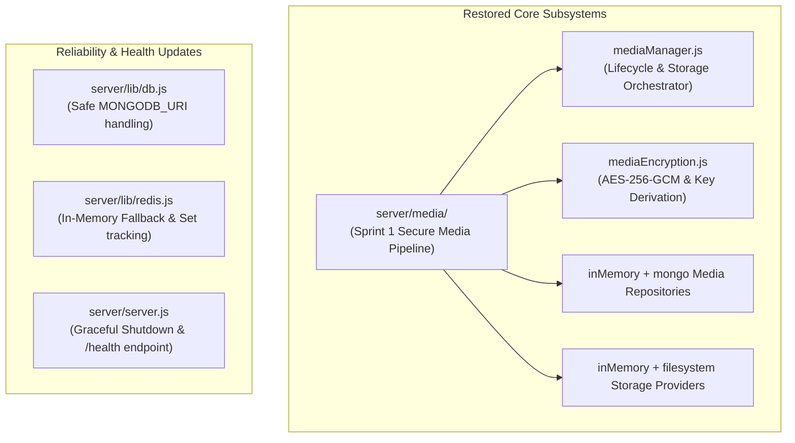

# PHASE 1 — FIX REPORT
**Audit & Remediation Phase:** Phase 1 (Baseline Restoration)  
**Date:** November 2026  
**Auditor / Engineer:** Senior Backend Engineer  

---

## 1. Summary of Changes

To restore reliable local execution and establish a green baseline, targeted changes were implemented across the backend server without altering existing chat behavior, database schemas, or package manifests.

---

## 2. Detailed File Modifications & Implementations

### A. Missing Media Pipeline (`server/media/`)
The Layer 11 Sprint 1 contract was fully implemented according to the frozen architecture specifications:

| File | Purpose & Real Contracts Satisfied |
| :--- | :--- |
| [`server/media/errors.js`](file:///home/pranav/Documents/MERN-Stack-Chat-App/server/media/errors.js) | Implements `MediaError`, `MediaNotFoundError` (404), `MediaValidationError` (400), `MediaIntegrityError` (422), `MediaOperationNotFoundError` (404). |
| [`server/media/encryption/mediaEncryption.js`](file:///home/pranav/Documents/MERN-Stack-Chat-App/server/media/encryption/mediaEncryption.js) | Implements `generateMediaKey()`, `encryptMedia()`, `decryptMedia()`, `mediaKeyFingerprint()`, and `sha256()`. Handles Buffer and base64 strings safely. |
| [`server/media/events/events.js`](file:///home/pranav/Documents/MERN-Stack-Chat-App/server/media/events/events.js) | Implements `MediaEventBus` with wildcard `*` dispatch and listener cleanup. |
| [`server/media/providers/inMemoryStorageProvider.js`](file:///home/pranav/Documents/MERN-Stack-Chat-App/server/media/providers/inMemoryStorageProvider.js) | Pluggable in-memory storage provider storing encrypted byte buffers. |
| [`server/media/providers/filesystemStorageProvider.js`](file:///home/pranav/Documents/MERN-Stack-Chat-App/server/media/providers/filesystemStorageProvider.js) | Filesystem storage provider writing encrypted binary files to `MEDIA_STORAGE_DIR`. |
| [`server/media/repository/inMemoryMediaRepository.js`](file:///home/pranav/Documents/MERN-Stack-Chat-App/server/media/repository/inMemoryMediaRepository.js) | In-memory CRUD operations for media metadata, operations, and integrity reports. |
| [`server/media/repository/mongoMediaRepository.js`](file:///home/pranav/Documents/MERN-Stack-Chat-App/server/media/repository/mongoMediaRepository.js) | Dual-mode repository querying Mongoose models if connected, falling back seamlessly to in-memory store. |
| [`server/media/models/MediaMetadata.model.js`](file:///home/pranav/Documents/MERN-Stack-Chat-App/server/media/models/MediaMetadata.model.js) | Mongoose schema registering `MediaMetadata` collection. |
| [`server/media/manager/mediaManager.js`](file:///home/pranav/Documents/MERN-Stack-Chat-App/server/media/manager/mediaManager.js) | Core orchestrator coordinating `uploadMedia`, `downloadMedia`, `getMetadata`, `deleteMedia`, `verifyMedia`, and diagnostics. Explicitly exposes monotonic `media.size` consumed by downstream chunkers. |
| [`server/media/api/mediaApi.js`](file:///home/pranav/Documents/MERN-Stack-Chat-App/server/media/api/mediaApi.js) | Express controller facade. |
| [`server/media/index.js`](file:///home/pranav/Documents/MERN-Stack-Chat-App/server/media/index.js) | Re-exports all public symbols. |
| [`server/media/tests/mediaManager.test.js`](file:///home/pranav/Documents/MERN-Stack-Chat-App/server/media/tests/mediaManager.test.js) | 5 regression unit tests for upload, download, tampering detection, and 404s. |

### B. Database Initialization ([`server/lib/db.js`](file:///home/pranav/Documents/MERN-Stack-Chat-App/server/lib/db.js))
- **Change:** Checks `if (!process.env.MONGODB_URI)` before calling `mongoose.connect()`.
- **Outcome:** Emits an informative console warning rather than crashing on `"undefined/chat-app"`. Normalizes trailing slashes and cleanly appends `/chat-app`.

### C. Resilient Redis Socket Store ([`server/lib/redis.js`](file:///home/pranav/Documents/MERN-Stack-Chat-App/server/lib/redis.js))
- **Change:** Added an in-memory `Map` fallback when Redis is unreachable or unconfigured. Suppressed connection error spam and added dual Redis Set tracking (`sadd("online_users")`, `smembers("online_users")`).
- **Outcome:** Socket connections and presence queries execute reliably without requiring an active local Redis server.

### D. Server Entry Point & Health Probes ([`server/server.js`](file:///home/pranav/Documents/MERN-Stack-Chat-App/server/server.js))
- **Change:**
  - Added structured health monitoring on `GET /api/status` returning `{ message, status, uptime, timestamp, services }`.
  - Added container probe endpoint `GET /health` returning HTTP 200 (healthy) or HTTP 503 (database degraded).
  - Added `SIGTERM` and `SIGINT` graceful shutdown hooks to drain server requests and close database/Redis connection pools cleanly.
